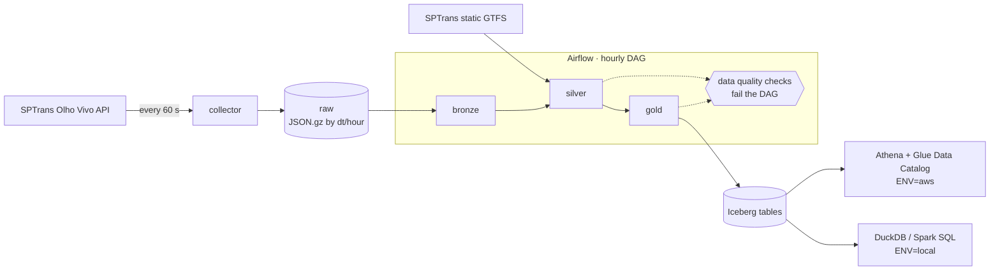

# SPTrans Telemetry Lakehouse

[](https://github.com/henriquegallas/sptrans-telemetry-lakehouse/actions/workflows/ci.yml)

> **Work in progress.** The project is being built in phases — see the [roadmap](#roadmap).

Continuously collects the GPS position of every bus running in São Paulo from the SPTrans
**Olho Vivo** API and turns it into a bronze/silver/gold lakehouse on **Apache Iceberg**, processed
with **PySpark** and orchestrated by **Airflow**. The gold layer exposes hourly operational metrics
per bus line — average speed, active fleet and long stops — queryable with **Athena** or locally,
at zero (or a few cents of) cloud cost.

## Architecture



The whole pipeline runs **100% locally** (`ENV=local`). AWS is an alternative mode (`ENV=aws`)
that only uses pay-per-use services with tiny volumes: S3, Glue Data Catalog, Athena and IAM.

## Stack

| Layer | Choice | Why |
|---|---|---|
| Language & tooling | Python 3.12, uv, ruff, pytest | Fast, reproducible environments from a single lockfile. |
| Processing | Spark 4 / PySpark (`local[*]`) | Same code runs locally and on EMR Serverless / Glue; no cluster bill. |
| Table format | Apache Iceberg | Athena and the Glue Data Catalog read it natively; partition overwrite and `MERGE` make reprocessing idempotent. |
| Orchestration | Airflow 3 on Docker Compose | Full Airflow semantics (backfill, `data_interval`) without paying for an always-on MWAA environment. |
| Ingestion | Lightweight Python collector | Polling an API every minute is a service's job, not a scheduler's. |
| Infrastructure | Terraform | Every AWS resource is created — and destroyed — as code, starting with a US$ 1 budget alert. |

Architecture decisions are recorded as ADRs in [`docs/adr/`](docs/adr/).

## Collector

A small Python service ([`collector/`](collector/)) that takes one snapshot of every bus position
per minute and lands it untouched in the raw zone.

- **Session handling:** logs in with `POST /Login/Autenticar` and reuses the session cookie. Sessions
  expire silently, so a `401` on a data call triggers one re-login.
- **Fixed-rate schedule:** snapshots stay 60 s apart however long a request takes; ticks missed
  during a long outage are skipped instead of fired in a burst.
- **Retries:** timeouts, connection errors, `429`, `5xx` and non-JSON bodies are retried with
  exponential backoff and jitter. After the last attempt the snapshot is skipped and the loop carries
  on. A rejected token stops the service, since retrying cannot fix it.
- **Raw landing:** the response body is stored byte for byte, gzipped, at
  `posicao/dt=YYYY-MM-DD/hour=HH/posicao_<UTC timestamp>.json.gz`, partitioned by UTC collection
  time. Files are written under a dot-prefixed temporary name and then renamed, so Spark never reads
  a partial file.
- **Logs:** one JSON object per line on stdout. The token travels in the login query string, so
  request URLs are kept out of logs and error messages.

API quirks found while building it, each handled in [`collector/client.py`](collector/client.py):

- A rejected token returns `200` with a JSON `false`, not `401`.
- A login request without a body gets `411 Length Required`.
- Cloudflare in front of the API rejects Python's default `urllib` User-Agent
  (`403 error code: 1010`), so the client sends its own.

## Running locally

Requirements: Docker with Compose, [uv](https://docs.astral.sh/uv/) and `make` (Linux, macOS or
WSL2).

1. Get a free API token in the [SPTrans developer area](https://www.sptrans.com.br/desenvolvedores/):
   create an account, then an application under "Meus Aplicativos".
2. Configure and start the stack:

```bash
cp .env.example .env   # then set SPTRANS_API_TOKEN
make up                # build and start the collector
make logs              # one JSON line per snapshot
```

Snapshots land in `data/raw/posicao/dt=YYYY-MM-DD/hour=HH/`; `make down` stops everything.
For development, `make install` creates the virtualenv and `make check` runs lint and tests.
`make help` lists every target.

### Configuration

Settings are resolved from, highest precedence first: the process environment, `.env` (secrets,
git-ignored) and `config/<ENV>.env` (non-secret settings per environment, committed).

| Variable | Default | Purpose |
|---|---|---|
| `ENV` | `local` | Selects `config/<ENV>.env` (`local` or `aws`). |
| `SPTRANS_API_TOKEN` | — | Olho Vivo API token. Secret: `.env` only. |
| `SPTRANS_API_BASE_URL` | config file | `https://api.olhovivo.sptrans.com.br/v2.1` |
| `COLLECTOR_RAW_DIR` | config file | Raw landing directory (`/data/raw` inside Docker). |
| `COLLECTOR_POLL_INTERVAL_SECONDS` | `60` | Time between snapshots. |
| `COLLECTOR_REQUEST_TIMEOUT_SECONDS` | `20` | Per-request HTTP timeout. |
| `COLLECTOR_MAX_ATTEMPTS` | `5` | Attempts per snapshot before waiting for the next tick. |
| `COLLECTOR_LOG_LEVEL` | `INFO` | `DEBUG`, `INFO`, `WARNING` or `ERROR`. |

## Running on AWS

_Coming in phase 7: Terraform (budget alert first), Glue Data Catalog + S3, Athena workgroup with a
scan limit, and expected costs._

## Data model

| Layer | Table | Grain |
|---|---|---|
| Bronze | `bronze.bus_positions_raw` | One row per vehicle per API snapshot, as received, plus ingestion metadata. |
| Silver | `silver.bus_positions` | One deduplicated position per `(vehicle_id, position_ts_utc)`, with speed and GTFS enrichment. |
| Gold | `gold.line_speed_hourly` | Average / p50 / p90 speed per line, direction and hour. |
| Gold | `gold.active_fleet_hourly` | Distinct vehicles per line and hour. |
| Gold | `gold.long_stops` | Periods where a vehicle stayed still for more than 5 minutes. |

_Column-level documentation will be added as each layer is implemented._

## Repository layout

```
collector/        SPTrans Olho Vivo collector service
spark_jobs/       PySpark jobs: common/, bronze/, silver/, gold/
dags/             Airflow DAGs
quality/          Data quality suites
infra/terraform/  AWS resources
docker/           Dockerfiles (Airflow, collector)
tests/            Unit and integration tests
docs/             Diagrams and ADRs
```

## Roadmap

- [x] **Phase 0 — Setup:** repository, uv, ruff, pytest, Makefile, CI
- [ ] **Phase 1 — Collector:** authentication, 60 s polling, retry with backoff, partitioned JSON.gz
- [ ] **Phase 2 — Bronze:** raw → Iceberg
- [ ] **Phase 3 — Silver:** cleaning, deduplication, speed, GTFS enrichment
- [ ] **Phase 4 — Gold:** hourly metrics tables
- [ ] **Phase 5 — Airflow:** hourly DAG, idempotency, backfill
- [ ] **Phase 6 — Data quality:** checks that fail the DAG
- [ ] **Phase 7 — AWS:** Terraform, Glue Catalog, S3, Athena
- [ ] **Phase 8 — Polish:** docs, example queries, ADRs
- [ ] **Phase 9 — Streaming (optional):** Redpanda + Spark Structured Streaming

## Development workflow

Branches follow `feature/<name>` off `development`; commits follow
[Conventional Commits](https://www.conventionalcommits.org/). `make check` (lint + tests) must pass
before every commit; CI runs the same Makefile targets, so a green `make check` means a green build.

## License

[MIT](LICENSE)
